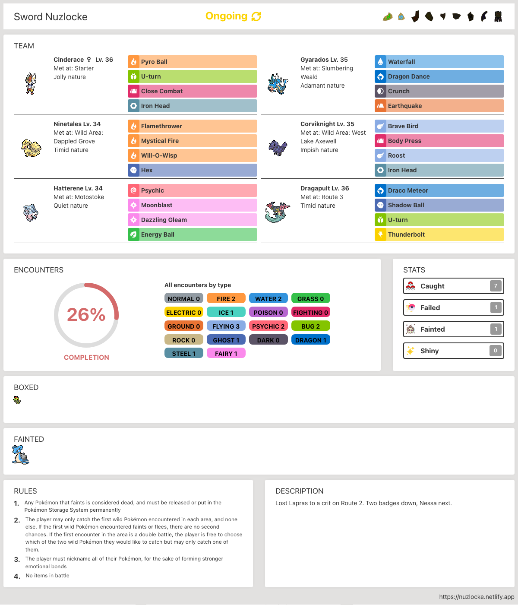

# Nuzlocke Tracker

[](https://app.netlify.com/sites/nuzlocke/deploys)  [](https://github.com/diballesteros/nuzlocke/issues)

## Table of Contents

- [About](#about)
  - [Features](#🚀-features)
  - [How it works](#✨-how-it-works)
- [Getting started](#getting-started)
- [Running the tests](#running-the-tests)
- [Roadmap](#roadmap)
- [Deployment](#deployment)
- [Versioning](#versioning)
- [Contributing](#contributing)
- [License](#license)
- [Acknowledgements](#acknowledgements)
- [Legal](#legal)

## About

https://nuzlocke.netlify.app

Web app to track and record encounters in any Pokémon game. Including custom games!

All Pokémon included up to generation 8.

Built with ReactJS, Typescript, Vite, Zustand, Tailwind CSS and shadcn/ui.

### 🚀 Features

- Record your encounters with detailed information, including: pokemon, level, gender, ability, nature, item and more!
- Accurate encounter tables for every location
- Level caps for all base games - customizable!
- Add and edit custom games and custom encounter locations
- Search and filter through all encounters - including only missing encounters
- Export, import and share Nuzlocke runs with others!
- Fully integrated damage calculator
- Share, add and edit custom rules and rulesets - including smart rules that alert if they're broken
- View overview and summary of your nuzlocke run
- Dupes clause alerts
- Works offline
- Nickname randomizer
- Details on all gym and Elite Four pokémon for all base games
- Download a summary image
- Build an ideal team with the Team Builder!
- Quick access to details on type effectiveness and natures
- Encounter suggestions
- Soul Link integrations

### ✨ How it works

- Adding Encounter:


- Editing Encounter:


- Badges:


- Team Builder:


- Damage Calculator:


- Summary Image:



## Getting started

### 💻 Installation

1. Clone the repo
   ```sh
   git clone https://github.com/diballesteros/nuzlocke.git
   cd nuzlocke
   ```
2. Install NPM packages
   ```sh
   npm install
   ```
3. Run the project locally
   ```bash
   npm run dev
   ```

## Running the tests

This project uses [Playwright](https://playwright.dev/) for end-to-end, persisted-state and visual tests. To run them:

```sh
npm run pw:e2e        # end-to-end journeys in Chromium (pw:e2e:all adds Firefox and WebKit)
npm run verify:state  # checks what each journey stores
npm run verify:visual # screenshot, ARIA and accessibility baselines (needs Docker)
```

`npm run verify` runs every check CI runs except the visual baselines.

This will run the unit tests:

```bash
npm run test
```

## Roadmap

See the [open issues](https://github.com/diballesteros/nuzlocke/issues) for a list of proposed features (and known issues).

## Deployment

The project automatically deploys to [Netlify](https://www.netlify.com/) when changes are detected on the **master** branch.

## Versioning

We use [SemVer](https://semver.org/) for versioning. For the versions available, see the [tags](https://github.com/diballesteros/nuzlocke/releases) on this repository.

## Contributing

Please read [CONTRIBUTING.md](https://github.com/diballesteros/nuzlocke/blob/master/CONTRIBUTING.md) for details on our code of conduct, and the process for submitting pull requests to us.

## License

This project is licensed under the BSD-3-Clause License - see the [LICENSE](https://github.com/diballesteros/nuzlocke/blob/master/LICENSE) file for details

## Acknowledgements

- Images provided by [Bulbapedia](https://bulbapedia.bulbagarden.net/wiki/Main_Page)
- Icons made by [Darius Dan](http://www.dariusdan.com) from [Flaticon](https://www.flaticon.com/)
- Icons made by [Roundicons Freebies](http://www.roundicons.com) from [Flaticon](https://www.flaticon.com/)
- Icons made by [Nikita Golubev](https://www.flaticon.com/authors/nikita-golubev) from [Flaticon](https://www.flaticon.com/)
- Icons made by [Freepik](https://www.freepik.com) from [Flaticon](https://www.flaticon.com/)
- Icons made by [Vectors Market](https://www.flaticon.com/authors/vectors-market) from [Flaticon](https://www.flaticon.com/)
- Nickname list provided by [Find Nicknames](https://www.findnicknames.com/pokemon-nicknames/)

## Legal

Pokémon © 2002-2025 Pokémon. © 1995-2025 Nintendo/Creatures Inc./GAME FREAK inc. TM, ® and Pokémon character names are trademarks of Nintendo.
